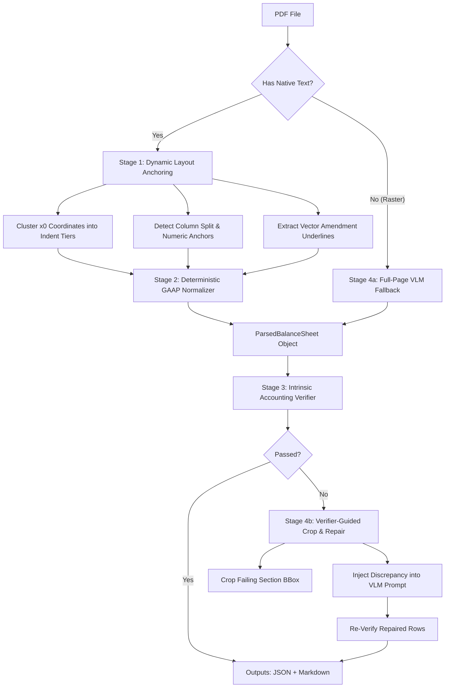

# High-Reliability J-GAAP Financial Table Parser & Evaluation Harness

> **Take-Home Challenge Solution**: Production-grade parser, zero-label accounting verifier, relational evaluation benchmark, and targeted VLM fallback pipeline for Japanese financial statements (連結貸借対照表 / Consolidated Balance Sheet).

---

## 1. Executive Summary: Defining & Measuring "Correct"

Generic OCR and document AI benchmarks (BLEU, Levenshtein, flat cell text accuracy, or naive Tree-Edit-Distance-based TEDS) evaluate tables as flat grids of strings. **On financial filings, this definition of "correct" is dangerous**:
- Dropping a Japanese negative sign (`△`) retains **98.6%** naive cell text accuracy while inverting balance sheet math by millions of yen.
- Flattening visual indentation achieves **100.0%** text accuracy while destroying the semantic ancestry of duplicate labels (`その他`, `減価償却累計額`), corrupting downstream databases.
- Collapsing `－` (nil balance) and `△0` (rounding balance) into `0` retains valid arithmetic while violating GAAP audit rules.

### Our Dual Evaluation Framework
We define and measure correctness across two complementary pillars:

1. **Intrinsic Zero-Label Verification ([src/verifier.py](src/verifier.py))**:
   - Evaluates internal mathematical consistency without requiring human annotations.
   - Verifies all **subtotal roll-ups** with bounded 千円-truncation tolerance.
   - Verifies all **gross / accumulated depreciation / net triplets** with bounded ±1 千円 drift tolerance.
   - Enforces **structural completeness** (non-empty data rows, empty section headers).
2. **Extrinsic Relational Tuple Evaluation ([src/evaluator.py](src/evaluator.py))**:
   - Represents the table as a set of canonical relational tuples:
     $$\text{Cell} = \big(\text{tuple}(\text{hierarchy\_path}), \text{role}, \text{period}, \text{effective\_value}, \text{is\_nil}, \text{is\_negative\_zero}, \text{is\_amended}\big)$$
   - Computes **Strict Relational F1**, **Numeric Value F1**, **Hierarchy Path Accuracy**, and **J-GAAP Semantic Accuracy** against ground truth.

---

## 2. The 5 Domain Traps in Japanese Financial Statements

Our physical inspection of `balance_sheet_after_correction.pdf` revealed 5 critical domain characteristics that break generic parsers:

### Trap 1: The ±1 千円 Truncation Drift in Rollups and Triplets
In J-GAAP filings reported in thousands of yen (千円単位), values are truncated or rounded *before* display.
- **Mathematical Proof for Triplets**:
  Let exact gross be $G$ and exact accumulated depreciation be $D$, so exact net is $N = G - D$.
  In the PDF, printed values are integers:
  $$\tilde{G} = \lfloor G / 1000 \rfloor, \quad \tilde{D} = \lfloor D / 1000 \rfloor, \quad \tilde{N} = \lfloor (G - D) / 1000 \rfloor$$
  Using the floor identity $\lfloor x - y \rfloor \in \{\lfloor x \rfloor - \lfloor y \rfloor, \lfloor x \rfloor - \lfloor y \rfloor - 1\}$, we obtain:
  $$\tilde{N} - (\tilde{G} - \tilde{D}) \in \{0, -1\}$$
  In `balance_sheet_after_correction.pdf`, this exact drift occurs on:
  - `建物及び構築物` (2026): Gross 1,880,082 + Depr -1,640,253 = 239,829 vs. Printed Net 239,828 ($\text{diff} = -1$)
  - `リース資産` (2025): Gross 210,746 + Depr -147,599 = 63,147 vs. Printed Net 63,146 ($\text{diff} = -1$)
  - `リース資産` (2026): Gross 213,939 + Depr -172,066 = 41,873 vs. Printed Net 41,872 ($\text{diff} = -1$)
  *Naive equality `gross + depr == net` fails on real filings.* Our verifier enforces strict bounds: `exact_match` ($\text{diff} == 0$) vs. `within_rounding_tolerance` ($|\text{diff}| \le 1$), while still rejecting true errors ($|\text{diff}| > 1$).
- **Subtotal Rollup Drift**:
  Similarly, for a subtotal summing $K$ line items, the cumulative truncation drift satisfies:
  $$\left|\text{PrintedSubtotal} - \sum_{i=1}^K \text{PrintedItem}_i\right| \le K$$
  Our verifier enforces $|\text{diff}| \le K$, allowing legitimate truncation drift (e.g., +3 千円 drift across 10 items in `流動資産合計`) while instantly flagging genuine errors.

### Trap 2: Nil (`－`) vs. Negative Zero (`△0`) GAAP Semantics
- **`－` (U+FF0D Fullwidth Hyphen-Minus)**: Represents a non-existent account balance this period (e.g. `建設仮勘定` and `長期貸付金` in prior period). Parsed as `is_nil=True, value=None`.
- **`△0` (Negative Zero)**: Represents an active account whose balance is non-zero but rounds to zero at the 千円 level (e.g. `貸倒引当金` in current period). Parsed as `is_negative_zero=True, value=0`.
- *Why it matters*: In financial audits, `is_nil` means the account was inactive, while `△0` means the account was active. Collapsing both to `0` destroys the audit trail.

### Trap 3: Repeated Labels & Visual Indentation Hierarchy
The PDF contains repeated account labels under different balance sheet branches:
- `その他`: Appears 4 distinct times (`流動資産`, `有形固定資産`, `無形固定資産`, `投資その他の資産`).
- `減価償却累計額`: Appears 4 distinct times under `有形固定資産`.
- `リース資産`: Appears under both `有形固定資産` and `無形固定資産`.

Our parser dynamically clusters $x_0$ coordinates into visual indentation tiers and reconstructs disambiguated ancestry:
- `["資産の部", "固定資産", "有形固定資産", "建物及び構築物", "減価償却累計額"]`
- `["資産の部", "固定資産", "有形固定資産", "機械装置及び運搬具", "減価償却累計額"]`

### Trap 4: Vector-Level Physical Amendment Underlines (訂正後 Filings)
In Japanese corrected filings (`（訂正後）`), amended cells are designated by a narrow black horizontal rule sitting directly beneath the amended numbers.
- In this PDF, lines sit ~8–10pt below text baseline ($h < 1.0\text{pt}, w < 60\text{pt}, \text{fill} == (0,0,0)$).
- Our vector drawing extractor links these rects to candidate cells, setting `is_amended=True` on exactly `218,836` (`投資有価証券`) and `1,123` (`関係会社株式`) in `2026-03-31`.

### Trap 5: Standalone Negative Triangle Symbols (`△` / `▲`)
In native PDF text streams, Japanese negative triangle markers (`△`, U+25B3) are emitted as separate spans to the left of the numeric text (e.g. `△` at $x_0=365.88$, `2,979` at $x_0=374.88$). Our parser groups spans on the same row horizontally and merges them into signed canonical values (`-2979`).

---

## 3. Hybrid Architecture



1. **Stage 1 — Dynamic Coordinate Anchoring ([src/parser.py](src/parser.py))**:
   - Auto-detects column boundaries from period headers and right-aligned numeric clusters.
   - Infers indentation tiers by 1D clustering of label $x_0$ values (grouping within 4pt tolerance).
   - Extracts vector drawing rects for physical amendment markings.
2. **Stage 2 — Deterministic GAAP Normalizer ([src/parser.py](src/parser.py))**:
   - Reconstructs hierarchy paths and semantic roles (`GROSS_ITEM`, `ACCUM_DEPR`, `NET_ITEM`, `SUBTOTAL`, `GRAND_TOTAL`).
   - Normalizes negative triangles and nil fullwidth hyphens into canonical dataclasses.
3. **Stage 3 — Intrinsic Zero-Label Verifier ([src/verifier.py](src/verifier.py))**:
   - Validates triplet consistency ($|\text{diff}| \le 1$).
   - Validates subtotal roll-ups ($|\text{diff}| \le K$).
   - Verifies structural completeness.
4. **Stage 4 — Verifier-Guided VLM Fallback & Repair ([src/vlm_fallback.py](src/vlm_fallback.py))**:
   - **Raster Fallback**: Automatically triggers when native text spans $= 0$.
   - **Targeted Crop-and-Repair**: When a subtotal or triplet check fails on noisy/rotated layouts, crops only the failing section BBox, passes the exact mathematical discrepancy to the VLM, and splices the corrected rows back into the table.
   - Includes `MockVLMClient` for 100% offline testing.

---

## 4. Failure-Mode Evaluation Benchmark

We benchmarked 7 scenarios comparing standard naive flat metrics against strict relational metrics and accounting verification on `data/balance_sheet_after_correction.pdf`:

| Scenario | Naive Flat Acc | Strict Tuple F1 | Numeric Val F1 | Hierarchy Acc | GAAP Semantic Acc | Accounting Verifier |
| :--- | :---: | :---: | :---: | :---: | :---: | :---: |
| **Hybrid Anchor Parser (Ours)** | **100.0%** | **100.0%** | **100.0%** | **100.0%** | **100.0%** | **PASS** |
| **Mutation 1: Dropped △ Sign** | 98.6% | 98.6% | 98.6% | 100.0% | 100.0% | **FAIL** (1) |
| **Mutation 2: Nil Cell Shift** | 98.6% | 96.6% | 96.6% | 100.0% | 80.0% | **FAIL** (2) |
| **Mutation 3: Flattened Hierarchy** | 100.0% | 0.0% | 0.0% | 2.3% | 0.0% | **FAIL** (12) |
| **Mutation 4: Triplet Role Blindness** | 100.0% | 78.4% | 100.0% | 81.4% | 100.0% | **FAIL** (2) |
| **Mutation 5: J-GAAP Nil/△0 Collapse** | 95.9% | 95.9% | 100.0% | 100.0% | 40.0% | **PASS** |
| **Mutation 6: Vector Underline Blindness** | 100.0% | 97.3% | 100.0% | 100.0% | 60.0% | **PASS** |

### Benchmark Takeaways:
- **Mutation 1 (Dropped Negative Sign)**: Standard OCR cell recall scores **98.6%** ("A+" grade), but the verifier immediately flags `流動資産合計` with a catastrophic **-5,955 千円 error**.
- **Mutation 3 (Flattened Indentation)**: Naive OCR metrics report **100.0% accuracy**, yet the relational output is completely corrupted (**0.0% Strict F1**) because section hierarchy was erased.
- **Mutation 5 & 6 (GAAP Semantics & Amendments)**: Arithmetic rollups pass, but **GAAP Semantic Accuracy** exposes the loss of audit flags (40.0% and 60.0%).

---

## 5. Quickstart & CLI Commands

### 1. Run Complete Test Suite (40/40 Passing)
```bash
py -m pytest
```

### 2. Parse Balance Sheet PDF & Generate Tables
```bash
py scripts/run_parse.py
```
- Outputs generated:
  - `outputs/parsed_balance_sheet.json`: Full Pydantic v2 serialized balance sheet with bounding boxes and GAAP metadata.
  - `outputs/parsed_balance_sheet.md`: Markdown table with visual indentations and verification summary.

### 3. Run Failure-Mode Evaluation Benchmark
```bash
py scripts/run_eval_benchmark.py
```
- Outputs generated:
  - `outputs/evaluation_benchmark.md`: Markdown ablation report across all 7 scenarios.
