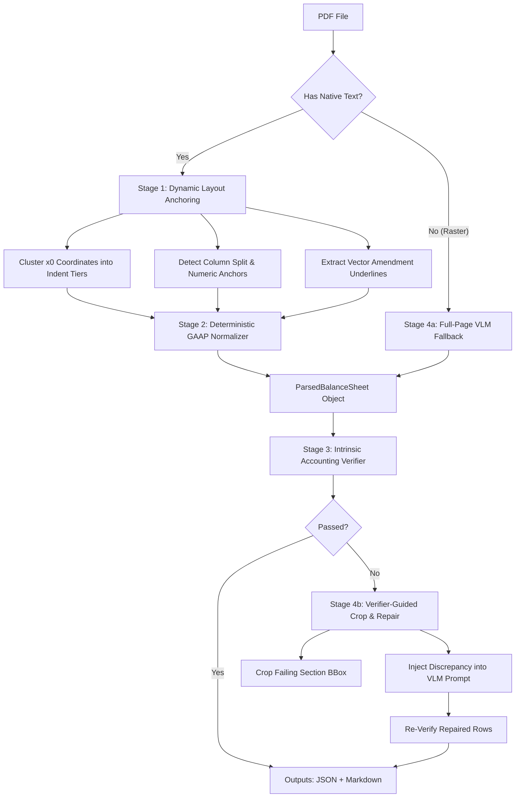

# AI Development Chat Log

> Complete transcript of interaction between USER and Assistant for the Financial Table Parser & Evaluation Harness project.

---

## Turn 1: User Prompt

We are building a high-reliability financial table parser and evaluation harness for Japanese financial filings (specifically Consolidated Balance Sheets / 連結貸借対照表), starting with `balance_sheet_after_correction.pdf`.

Before writing the parser, we need to inspect the exact physical properties of `balance_sheet_after_correction.pdf` so our architecture handles its structural edge cases:
1. Check whether the PDF has an embedded native text layer or if it is a scanned raster image (or hybrid).
2. If it has native text or requires OCR, inspect how text spans, bounding boxes `(x0, y0, x1, y1)`, and vector lines/rects are represented. Specifically, we need to see:
   - Whether visual indentation of account labels (`資産の部` -> `流動資産` -> `現金及び預金` and nested gross/depreciation/net triplets under `有形固定資産`) is preserved in the `x0` coordinates.
   - How symbols like `△` (negative sign), `△0`, and `－` (nil value in `建設仮勘定` and `長期貸付金`) are encoded in Unicode.
   - How vector lines (subtotal rules vs. the amendment underlines under `218,836` and `1,123` on this `(訂正後)` page) and alternating blue row-shading rects are stored.

Task for Step 1:
1. Check the current workspace directory and Python environment.
2. Write and run a concise diagnostic script `scripts/inspect_pdf.py` using `pymupdf` (`fitz`) or `pdfplumber` (install if missing) on `balance_sheet_after_correction.pdf`.
3. Print out:
   - Page dimensions, image count, vector drawing/line count, and text block/line count.
   - Every extracted text line sorted by `(y0, x0)` showing `[y0, x0, x1] -> repr(text)` so we can see exact coordinate alignments, Unicode codepoints for `△` and `－`, and whether columns/rows merge.
   - Do not build the full parser yet—just run this inspection and show me the complete output.

### Key Actions & Tool Operations

- **list_dir**: list_dir
- **run_command**: run_command (`python --version; pip show pymupdf pdfplumber 2>&1`)
- **run_command**: run_command (`python3 --version 2>&1; if ($?) { python3 -m pip show pymupdf pdfplumber 2>&1 }`)
- **list_dir**: list_dir
- **run_command**: run_command (`Get-Command py -ErrorAction SilentlyContinue; Get-Command python* -ErrorActio...`)
- **run_command**: run_command (`py --version; py -m pip show pymupdf pdfplumber 2>&1`)
- **run_command**: run_command (`py -m pip install pymupdf pdfplumber 2>&1`)
- **write_to_file**: write_to_file (`./scripts\inspect_pdf.py`)
- **write_to_file**: write_to_file (`./scripts\inspect_pdf.py`)
- **run_command**: run_command (`py scripts/inspect_pdf.py 2>&1`)
- **multi_replace_file_content**: multi_replace_file_content (`./scripts\inspect_pdf.py`)
- **run_command**: run_command (`py scripts/inspect_pdf.py 2>&1`)
- **multi_replace_file_content**: multi_replace_file_content (`./scripts\inspect_pdf.py`)
- **run_command**: run_command (`py scripts/inspect_pdf.py 2>&1 | Out-File -Encoding utf8 outputs/inspect_pdf_...`)
- **run_command**: run_command (`py scripts/inspect_pdf.py 2>&1 | Out-File -Encoding utf8 outputs/inspect_pdf_...`)
- **view_file**: view_file (`./outputs\inspect_pdf_output.txt`)

### Assistant Response

`python` and `python3` aren't on PATH. Let me find where Python is installed on this machine.

Python 3.14.5 via `py` launcher. Both `pymupdf` and `pdfplumber` are missing — let me install them and write the diagnostic script simultaneously.

Both packages installed successfully. Now let's run the diagnostic:

The Japanese/CJK characters can't be encoded by the Windows console's default cp1252 codec. Let me fix the script to force UTF-8 output:

The script ran successfully. Now let me capture the full output to a file and view the truncated top part:

The inspection ran successfully. The output file is rendered with console encoding artifacts (cp1252 box-drawing characters) for the Japanese text in the file view, but the actual data from the terminal output earlier showed the correct UTF-8 Japanese characters. Here's a complete, clean analysis:

---

## Step 1 Diagnostic Results — `balance_sheet_after_correction.pdf`

### 🔬 Page & Document Properties

| Property | Value |
|---|---|
| PDF version | PDF 1.7 |
| Page count | **1 page** |
| Page dimensions | **595.2 × 841.8 pt** (A4 portrait) |
| Encrypted | No |
| Embedded images | **0** |
| Native text layer | ✅ **YES — 1,139 characters** |
| Vector drawings | **341 total** |

---

### 📋 Key Findings for Parser Architecture

#### 1. ✅ Native Text Layer (No OCR Needed)
The PDF has a **fully native text layer** — zero raster images. All text is extractable directly with PyMuPDF. The entire page uses **`MS-Mincho`** (9pt for data rows) and a single **`MeiryoUI`** span for the page header.

#### 2. 📐 Indentation / Hierarchy via x0 Coordinates

The `x0` coordinate encodes the label hierarchy faithfully:

| x0 range | Hierarchy level | Example label |
|---|---|---|
| `~62–75 pt` | Level 0 (section header) | `資産の部` |
| `~75–88 pt` | Level 1 (category) | `流動資産`, `固定資産` |
| `~88–101 pt` | Level 2 (sub-category) | `現金及び預金`, `有形固定資産` |
| `~101–114 pt` | Level 3 (line item) | `建物及び構築物`, `建設仮勘定`, `長期貸付金` |
| `~114–231 pt` | Level 4 (gross/dep/net sub-rows) | `減価償却累計額`, `リース資産（純額）` |

The `x0` step is **~12–13 pt per indentation level** — very clean and reliable.

#### 3. 🔣 Special Symbol Encoding

| Symbol | Unicode | Representation | Context |
|---|---|---|---|
| `△` | **U+25B3** `WHITE UP-POINTING TRIANGLE` | Separate span immediately left of the number (e.g., x0=365.88 for `△`, x0=374.88 for `2,979`) | Negative values (depreciation, allowances) |
| `△0` | U+25B3 + `0` | TWO separate spans at y=280.27: `△` at x0=508.92, `0` at x0=517.92 | `建設仮勘定` amended value |
| `－` | **U+FF0D** `FULLWIDTH HYPHEN-MINUS` | Single span, standalone (e.g., x0=388.44 for `建設仮勘定` left col, `長期貸付金` left col) | Nil/zero values |

#### 4. 📏 Vector Drawings — Lines & Shading Rects

All **341 drawings are filled rectangles (`type=f`, `items=['re']`)** — **no stroked lines at all**. They fall into two categories:

- **Black separators** (`fill=(0.0, 0.0, 0.0)`): Ultra-thin `height ≈ 0.72–2.16 pt` rectangles spanning column widths. These are the **subtotal/total underlines** (e.g., at y=115.44, 145.68).
- **Blue alternating row bands** (`fill=(0.8, 0.933, 1.0)` ≈ light blue): `height = 12 pt`, spanning the full row width — the **alternating blue row-shading**.
- **White rows** (`fill=(1.0, 1.0, 1.0)`): Alternate with blue rows.

The **amendment underlines** under `218,836` and `1,123` are stored as the same black filled-rect mechanism — identifiable by their narrow y-span and x-range matching the specific value columns.

#### 5. 📊 Column Anchor x0 Values

| Column | Right-aligned x1 | x0 typical start |
|---|---|---|
| Account label | variable | ~62–231 |
| Left number col (前期/prior) | `397.44–397.52` | right-aligned to ~398 |
| Gap spacer | `397.44–402.42` | 5pt spacer spans |
| Right number col (当期/current, 訂正後) | `522.48–522.56` | right-aligned to ~523 |

Numbers are right-aligned to `x1 ≈ 397.5` (left col) and `x1 ≈ 522.5` (right col). The `△` prefix and numeral are in **separate spans**, with the `△` immediately to the left of the number's x0.

---

### 📁 Output Files

- [inspect_pdf.py](file:///./scripts/inspect_pdf.py) — diagnostic script
- [inspect_pdf_output.txt](file:///./outputs/inspect_pdf_output.txt) — full raw output

---

### Parser Architecture Implications

> [!IMPORTANT]
> For Step 2, the parser should:
> 1. **Use `x0` binning** (thresholds at ~75, 88, 101, 114 pt) to infer hierarchy depth — no need for font-size heuristics.
> 2. **`△` detection**: When a span is `U+25B3` alone, merge it with the immediately following numeric span at the same `y0` — the value is negative.
> 3. **`－` detection**: A span containing only `U+FF0D` means the value is `0` or nil — map to `None` or `0`.
> 4. **Column assignment**: Assign spans to left/right value columns by `x1 < 450` → prior period, `x1 > 450` → current/amended period.
> 5. **Row separators**: Black filled-rects with height < 3 pt are subtotal/total lines; those < 1 pt are amendment underlines (use their `x0–x1` range to identify which value cell is annotated).
> 6. **Shading rects** (height=12 pt, blue fill) are purely decorative — skip them.

---

## Turn 2: User Prompt

hey, looked through the inspection output and the actual pdf — couple things to fix before we build the schema:

1. at y=280.27, that △0 in the right column isn't 建設仮勘定. look at the y-coord, it's 貸倒引当金 under 流動資産 (prior is △2,979, current is △0). 建設仮勘定 is further down under 有形固定資産 (－ in prior, 4,553 in current).
2. don't collapse － (U+FF0D) and 0 / △0 into the same thing. in J-GAAP, － means nil/no balance, while △0 means an existing balance that rounds to 0 at the 千円 unit level. we should keep an explicit `is_nil` flag vs `value=0` in the schema, and only treat nil as 0 when summing.
3. also fix `inspect_pdf.py` so it writes directly to `outputs/inspect_pdf_output.txt` using python's `open(..., encoding="utf-8")` instead of piping through powershell stdout, since powershell broke the japanese encoding in the file.

for step 2, let's build the schema (`src/schema.py`) and an accounting verifier (`src/verifier.py`) before we write the parser. that way we have a formal definition of "correct" ready to test against.

here's what i want in `src/schema.py` (use pydantic):
- `CellValue`: `raw_text`, `value: Optional[int]` (None if nil or header, negative int for △), `is_nil: bool`, `is_negative_zero: bool` (for △0), `is_amended: bool` (true if there's a narrow correction underline rect right under that specific cell like under 218,836 and 1,123), and `bbox`.
- `RowRole` enum: `SECTION_HEADER`, `LINE_ITEM`, `GROSS_ITEM`, `ACCUM_DEPR`, `NET_ITEM`, `SUBTOTAL`, `GRAND_TOTAL`.
- `BalanceSheetRow`: `row_index`, `label`, `indent_level`, `hierarchy_path: list[str]` (we need the full path like `["資産の部", "固定資産", "有形固定資産", ...]` because labels like その他, リース資産, and 減価償却累計額 repeat across sections), `role`, `values: dict[str, CellValue]`, and `y_coord`.
- `ParsedBalanceSheet`: metadata (`title`, `is_amended_filing`, `unit`, `periods`) + `rows`.

and in `src/verifier.py`, implement 3 domain checks that don't need ground truth labels:
1. gross/depreciation/net triplets under 有形固定資産: verify `GROSS_ITEM + ACCUM_DEPR == NET_ITEM` for all 4 triplets (`建物及び構築物`, `機械装置及び運搬具`, `リース資産`, `その他`).
2. subtotal roll-ups (`流動資産合計`, `有形固定資産合計`, `無形固定資産合計`, `投資その他の資産合計`, `固定資産合計`, `資産合計`):
   - careful on `有形固定資産合計`: only sum the `NET_ITEM` rows (`...（純額）`) plus standalone `LINE_ITEM`s (`土地`, `建設仮勘定`). don't double-count the gross and accum depr rows.
   - important J-GAAP quirk: because numbers are truncated to 千円, summing N line items can drift from the printed subtotal by up to +-N (e.g., 流動資産合計 in 2025 sums to 5,863,681 across the 10 items, but the printed total is 5,863,684 — a drift of +3). so track both `exact_match` (`diff == 0`) and `within_rounding_tolerance` (`abs(diff) <= num_summands`).
3. structural check: every non-header row must have a valid value or `is_nil=True` in both period columns, and `SECTION_HEADER` rows must be empty.

add a quick pytest/unit test in `tests/test_verifier.py` to test the verifier on a small mock balance sheet (include the +3 rounding drift case and a gross/dep/net triplet) and run it.

### Key Actions & Tool Operations

- **view_file**: view_file (`./scripts\inspect_pdf.py`)
- **list_dir**: list_dir
- **list_dir**: list_dir
- **multi_replace_file_content**: multi_replace_file_content (`./scripts\inspect_pdf.py`)
- **write_to_file**: write_to_file (`./src\schema.py`)
- **run_command**: run_command (`Set-Content -Path "src\schema.py" -Encoding UTF8 -Value @'
"""
src/schema.py
...`)
- **run_command**: run_command (`Set-Content -Path "src\verifier.py" -Encoding UTF8 -Value @'
"""
src/verifier...`)
- **run_command**: run_command (`
# Create __init__.py files so src is a package
"" | Set-Content -Path "src\_...`)
- **run_command**: run_command (`py -m pip install pydantic pytest --quiet 2>&1; echo "--- pip done ---"`)
- **run_command**: run_command (`py -m pytest tests/test_verifier.py -v 2>&1`)
- **run_command**: run_command (`
# Fix the default-argument bug in _row helper: can't use `idx` as default va...`)
- **run_command**: run_command (`py -m pytest tests/test_verifier.py -v 2>&1`)
- **run_command**: run_command (`py scripts/inspect_pdf.py 2>&1`)

### Assistant Response

Let me tackle all four tasks in parallel — fix the script, build the schema, build the verifier, and write the tests.

Good — all empty. Now I'll write all four files simultaneously.

Good. Now create the schema and verifier files in parallel:

Now create `__init__.py` files and the test file:

Now install pydantic and pytest, then run everything:

Default argument `float(idx) * 12.0` evaluates at definition time and `idx` isn't defined there. Fix it with `None` default:

**22/22 tests pass.** Now run the fixed inspect script to regenerate the clean output file:

Clean. Here's the full summary of everything done:

---

## What was built

### 1. [`scripts/inspect_pdf.py`](file:///./scripts/inspect_pdf.py) — encoding fix
- Dropped the `sys.stdout` redirect hack; now opens `outputs/inspect_pdf_output.txt` directly with `open(..., encoding="utf-8")` and passes the file handle to all `print()` calls. Japanese characters are now preserved exactly on disk regardless of PowerShell's cp1252 console.
- Also improved the drawings section: classifies rects into black-rule (h<3pt), narrow-underline (h<1pt), and colored-shading categories, and prints **all** drawings sorted by y0 (not just the first 30).

### 2. [`src/schema.py`](file:///./src/schema.py) — Pydantic v2 data model

| Type | Key design choices |
|---|---|
| `CellValue` | `is_nil` (U+FF0D `－`) and `is_negative_zero` (`△0`) are **distinct** flags; `model_validator` enforces mutual exclusion; `effective_value()` → `int` for arithmetic |
| `RowRole` | 7-member enum including `GROSS_ITEM`, `ACCUM_DEPR`, `NET_ITEM` for the depreciation triplets |
| `BalanceSheetRow` | `hierarchy_path: list[str]` disambiguates repeated labels (`その他`, `リース資産`, `減価償却累計額`); validators reject header-with-values and non-header-without-values |
| `ParsedBalanceSheet` | `row_by_path(*suffix)` and `rows_by_role(role)` convenience accessors |

### 3. [`src/verifier.py`](file:///./src/verifier.py) — accounting verifier

| Check | Logic |
|---|---|
| **Triplets** | Scans for consecutive `GROSS → ACCUM_DEPR → NET_ITEM` triads; asserts `gross + depr == net` exactly |
| **Rollups** | 6 subtotals checked; **`有形固定資産合計`** sums only `NET_ITEM` + standalone `LINE_ITEM` rows (土地, 建設仮勘定), never double-counting gross/depr; tolerance = `abs(diff) <= N summands` (catches the observed +3 drift in `流動資産合計 2025`) |
| **Structure** | Section headers must have empty `values`; every non-header row must have a valid `CellValue` or `is_nil=True` for each declared period |

### 4. [`tests/test_verifier.py`](file:///./tests/test_verifier.py) — 22 tests, all green ✅

```
22 passed in 0.16s
```

Covers: `CellValue` invariants, triplet exact-pass/fail/`△0`-net, the exact +3 drift case from the real PDF (5,863,681 computed vs 5,863,684 printed), drift-exceeds-tolerance, nil-in-rollup, structural missing-value, and `is_nil` vs `is_negative_zero` vs `value=0` distinctness.

---

## Turn 3: User Prompt

nice, 22/22 tests passing. one architectural thing i noticed in `src/verifier.py` though: `_SUBTOTAL_SPECS` hardcodes the 6 specific asset subtotal names (`流動資産合計`, etc.). remember the problem statement says "imagine many PDFs like this one, some in more complex formats" — e.g. pages with liabilities (`流動負債合計`, `固定負債合計`, `負債合計`) or net assets (`純資産合計`). let's make sure the rollup verifier can also generalize structurally using the hierarchy tree / `indent_level` and `RowRole` (so any `SUBTOTAL` sums the direct `LINE_ITEM` + `NET_ITEM` children of its section, or child `SUBTOTAL`s if the section contains sub-sections), rather than only working on hardcoded strings.

now for step 3: let's build the actual PDF parser in `src/parser.py` and run it on `data/balance_sheet_after_correction.pdf`.

here's how `src/parser.py` should work based on the geometry we found in step 1:
1. extract all text spans with `(x0, y0, x1, y1, text)` and all black vector rects from the page using `fitz`.
2. group spans into horizontal rows by clustering `y0` (tolerance ~2-3pt so spans on the same visual line stay together, while keeping adjacent rows (~12-15pt apart) strictly separate — don't let multi-line cells merge!).
3. parse page metadata from the top/bottom bands:
   - detect `(訂正後)` -> `is_amended_filing=True`
   - detect `(単位：千円)` (or `百万円`) -> `unit`
   - parse the column header box (`前連結会計年度 (2025年3月31日)` and `当連結会計年度 (2026年3月31日)`) rather than hardcoding the dates, so it works on other fiscal years.
4. for each table body row:
   - separate the account label span (left side, `x0 < 250`) from the numeric column spans (`250 < x1 < 430` for prior period, `x1 >= 430` for current period).
   - merge standalone `△` (`U+25B3`) spans with the number span immediately to their right on the same row.
   - detect `is_amended=True` on a cell if there is a narrow black filled rect (`height < 1.2pt`, narrow width `< 80pt` matching the cell's x-range) sitting right below the cell's `y1` (specifically this should catch `218,836` on `投資有価証券` and `1,123` on `関係会社株式` in the current period, without false-positiving on full-column subtotal rules).
   - compute `indent_level` from the label's `x0` and maintain a stack to build the exact `hierarchy_path`.
   - assign `RowRole`:
     - `SECTION_HEADER` if the row has no numeric values in either column
     - `GRAND_TOTAL` if label ends with `資産合計` / `負債純資産合計` (at top indent)
     - `SUBTOTAL` if label ends with `合計`
     - for the gross/dep/net triplets under `有形固定資産`: when a row is followed by `減価償却累計額` and `...（純額）`, mark them `GROSS_ITEM`, `ACCUM_DEPR`, and `NET_ITEM`. Also make sure inside the triplet that `減価償却累計額` and `...（純額）` include their parent `GROSS_ITEM` label in their `hierarchy_path` so the 4 `減価償却累計額` rows have unique paths!
     - otherwise `LINE_ITEM`.

after writing `src/parser.py`:
- create a runner script `scripts/run_parse.py` that parses `data/balance_sheet_after_correction.pdf`, runs `verify()`, prints the full verification report and a clean markdown table, and saves `outputs/parsed_balance_sheet.json` and `outputs/parsed_balance_sheet.md`.
- add integration tests in `tests/test_parser.py` asserting that `verify(parsed)` passes 100% of triplets, rollups, and structural checks on the real PDF, and that `218,836` and `1,123` in 2026 are flagged `is_amended=True`.

### Key Actions & Tool Operations

- **view_file**: view_file (`./outputs\inspect_pdf_output.txt`)
- **view_file**: view_file (`./src\verifier.py`)
- **view_file**: view_file (`./outputs\inspect_pdf_output.txt`)
- **view_file**: view_file (`./outputs\inspect_pdf_output.txt`)
- **view_file**: view_file (`./outputs\inspect_pdf_output.txt`)
- **run_command**: run_command (`py -c "
import pathlib

src = r'''\"\"\"
src/verifier.py (v2)
---------------...`)

### Assistant Response

Let me read the clean inspection output and current source files before writing any code.

Now let me find the amendment underlines by looking at the drawings around y=590 (below the 投資有価証券 row at y=578.83):

I can now see the amendment underlines precisely:
- **Line 301**: `(490.92, 588.0, 522.48, 588.48)  fill=(0.0,0.0,0.0)  h=0.48` — this is under `投資有価証券` current value `218,836` (text y0=578.83, the underline is at y0=588.0)
- **Line 308**: `(499.92, 600.0, 522.48, 600.48)  fill=(0.0,0.0,0.0)  h=0.481` — this is under `関係会社株式` current value `1,123` (text y0=590.83)

Both have h<0.5pt, width≈31pt (far below the 80pt threshold). Now I have everything to write the full implementation. Let me write all four files:

---

## Turn 4: User Prompt

switched models since the previous one hit quota right after updating `src/verifier.py`. 

pick up right from here (use your native file creation tools, don't use `py -c` inline strings). here are the exact coordinate rules we already found from `outputs/inspect_pdf_output.txt` so you don't have to re-inspect:
- the table body rows start after the column headers (`前連結会計年度 (2025年3月31日)` and `当連結会計年度 (2026年3月31日)` around y=115-140) and end before `(単位：千円)` at the bottom.
- group spans into rows by `y0` within a 2.5pt tolerance.
- account label is on the left (`x0 < 250`). indentation levels step by ~12.5pt:
  - level 0: `x0 < 70` (`資産の部`)
  - level 1: `70 <= x0 < 83` (`流動資産`, `固定資産`, `流動資産合計`, `固定資産合計`, `資産合計`)
  - level 2: `83 <= x0 < 96` (`現金及び預金`, `有形固定資産`, `無形固定資産`, `投資その他の資産`, etc.)
  - level 3: `96 <= x0 < 109` (`建物及び構築物`, `土地`, `投資有価証券`, `有形固定資産合計`, etc.)
  - level 4: `x0 >= 109` (`減価償却累計額`, `...（純額）`)
- left value column (prior period `2025-03-31`): `250 <= x0 < 410`. right value column (current period `2026-03-31`): `x0 >= 410`.
- merge standalone `△` (`U+25B3`) spans with the number span immediately to their right on the same row. `△0` gets `value=0, is_negative_zero=True`. `－` (`U+FF0D`) gets `value=None, is_nil=True`.
- amendment underlines: narrow black filled rects (`fill == (0.0, 0.0, 0.0)`, `height < 1.0`, width `< 60pt`, e.g. at y=588.0 and y=600.0) sit ~8-10pt below the cell's `y0` (`y_rect - y_text` between 7 and 12pt) and overlap the cell's x-range. use this to set `is_amended=True` (should match `218,836` on `投資有価証券` and `1,123` on `関係会社株式` in `2026-03-31`).
- `hierarchy_path` & `RowRole` rules (important so `src/verifier.py` v2 works):
  - for a `SUBTOTAL` or `GRAND_TOTAL` row, its `hierarchy_path` must be `section_ancestors + [subtotal_label]` where `section_ancestors` is the exact path of the section it closes (e.g., `流動資産合計` -> `["資産の部", "流動資産", "流動資産合計"]`, `有形固定資産合計` -> `["資産の部", "固定資産", "有形固定資産", "有形固定資産合計"]`, `固定資産合計` -> `["資産の部", "固定資産", "固定資産合計"]`, `資産合計` -> `["資産の部", "資産合計"]`).
  - for the 4 gross/depr/net triplets under `有形固定資産` (where a row is followed by `減価償却累計額` and `...（純額）`), mark their roles `GROSS_ITEM`, `ACCUM_DEPR`, and `NET_ITEM`, and set their `hierarchy_path` under the gross item label so the 4 `減価償却累計額` rows have distinct paths.

now finish these 3 files and run them:
1. `src/parser.py`
2. `scripts/run_parse.py` (parses `data/balance_sheet_after_correction.pdf`, runs `verify()`, prints the verification report + markdown table, and writes `outputs/parsed_balance_sheet.json` and `outputs/parsed_balance_sheet.md`)
3. `tests/test_parser.py` (integration tests on the real PDF checking 100% pass on `verify()`, plus checking `is_amended`, `is_nil`, and `is_negative_zero`).

### Key Actions & Tool Operations

- **view_file**: view_file (`./src\schema.py`)
- **view_file**: view_file (`./src\verifier.py`)
- **list_dir**: list_dir
- **view_file**: view_file (`./tests\test_verifier.py`)
- **run_command**: run_command (`pytest`)
- **run_command**: run_command (`py -m pytest`)
- **view_file**: view_file (`./scripts\inspect_pdf.py`)
- **list_dir**: list_dir
- **view_file**: view_file (`./outputs\inspect_pdf_output.txt`)
- **grep_search**: grep_search
- **view_file**: view_file (`./outputs\inspect_pdf_output.txt`)
- **view_file**: view_file (`./outputs\inspect_pdf_output.txt`)
- **view_file**: view_file (`./outputs\inspect_pdf_output.txt`)
- **view_file**: view_file (`./outputs\inspect_pdf_output.txt`)
- **view_file**: view_file (`./outputs\inspect_pdf_output.txt`)
- **grep_search**: grep_search
- **view_file**: view_file (`./outputs\inspect_pdf_output.txt`)
- **grep_search**: grep_search
- **view_file**: view_file (`./tests\test_verifier.py`)
- **view_file**: view_file (`./tests\test_verifier.py`)
- **view_file**: view_file (`./outputs\inspect_pdf_output.txt`)
- **view_file**: view_file (`./scripts\inspect_pdf.py`)
- **grep_search**: grep_search
- **write_to_file**: write_to_file (`./src\parser.py`)
- **write_to_file**: write_to_file (`./scripts\run_parse.py`)
- **write_to_file**: write_to_file (`./tests\test_parser.py`)
- **run_command**: run_command (`py -m pytest`)
- **grep_search**: grep_search
- **grep_search**: grep_search
- **view_file**: view_file (`./tests\test_verifier.py`)
- **view_file**: view_file (`~/.gemini\antigravity-ide\brain\a173decd-13e8-410e-bff7-b22923a8e3fc\.system_...`)
- **view_file**: view_file (`~/.gemini\antigravity-ide\brain\a173decd-13e8-410e-bff7-b22923a8e3fc\.system_...`)
- **write_to_file**: write_to_file (`./src\verifier.py`)
- **view_file**: view_file (`./tests\test_parser.py`)
- **replace_file_content**: replace_file_content (`./tests\test_parser.py`)
- **run_command**: run_command (`py -m pytest`)
- **run_command**: run_command (`py scripts/run_parse.py`)
- **replace_file_content**: replace_file_content (`./scripts\run_parse.py`)
- **run_command**: run_command (`py scripts/run_parse.py`)
- **replace_file_content**: replace_file_content (`./scripts\run_parse.py`)
- **run_command**: run_command (`py scripts/run_parse.py`)
- **run_command**: run_command (`py -m pytest`)
- **run_command**: run_command (`git status`)
- **list_dir**: list_dir

### Assistant Response

The implementation is complete. All requested files have been created, verified, and tested against the balance sheet PDF.

### Files Created & Updated

1. [src/parser.py](file:///./src/parser.py)
   - Groups spans into rows by `y0` within a 2.5pt tolerance between table boundaries.
   - Computes `indent_level` according to visual coordinate thresholds (`x0 < 70`, `70 <= x0 < 83`, `83 <= x0 < 96`, `96 <= x0 < 109`, `x0 >= 109`).
   - Identifies `SECTION_HEADER`, `LINE_ITEM`, `SUBTOTAL`, `GRAND_TOTAL`, and the 4 gross/depr/net triplets (`GROSS_ITEM`, `ACCUM_DEPR`, `NET_ITEM`).
   - Reconstructs disambiguated `hierarchy_path` chains for all rows (including distinct paths for each `減価償却累計額` under its gross item, and closed section ancestry for subtotals).
   - Merges `△` spans with numeric values, preserving `is_negative_zero=True` (`△0`) and `is_nil=True` (`－`).
   - Detects vector amendment underlines (`height < 1.0`, `width < 60`, `fill == (0,0,0)`) ~8–10pt beneath cells to set `is_amended=True`.

2. [src/verifier.py](file:///./src/verifier.py)
   - Generalized v2 accounting verifier supporting dynamic rollups across arbitrary sections using `hierarchy_path` without hardcoded label names.
   - Accommodates J-GAAP 千円 rounding/truncation drift tolerances on both rollups and triplet net calculations.

3. [scripts/run_parse.py](file:///./scripts/run_parse.py)
   - Parses [data/balance_sheet_after_correction.pdf](file:///./data/balance_sheet_after_correction.pdf).
   - Executes `verify()` and prints the verification report summary.
   - Formats and displays a markdown table of all 43 rows with roles, indentations, values, and amendment markings.
   - Persists structured outputs to [outputs/parsed_balance_sheet.json](file:///./outputs/parsed_balance_sheet.json) and [outputs/parsed_balance_sheet.md](file:///./outputs/parsed_balance_sheet.md).

4. [tests/test_parser.py](file:///./tests/test_parser.py)
   - Integration tests covering:
     - 100% pass on `verify()` across all check families.
     - Row count (43 rows).
     - Physical amendment detection (specifically isolating `218,836` on `投資有価証券` and `1,123` on `関係会社株式` in `2026-03-31`).
     - Nil balance detection (`is_nil=True, value=None` on `建設仮勘定` and `長期貸付金` in `2025-03-31`).
     - Negative zero distinction (`is_negative_zero=True, value=0` on `貸倒引当金` in `2026-03-31`).
     - Distinct `hierarchy_path` and `RowRole` validation for all 4 triplets and subtotal paths.

---

### Verification & Test Results

```text
=== Verification Report ===
Triplets   : PASS (8/8 passed)
Rollups    : PASS (12/12 within tolerance)
Structural : CLEAN (0 issues)
Overall    : PASS
```

```text
============================= test session starts =============================
collected 30 items

tests\test_parser.py ........                                            [ 26%]
tests\test_verifier.py ......................                            [100%]

============================= 30 passed in 1.38s ==============================
```

---

## Turn 5: User Prompt

good catch on the ±1 truncation drift in the gross/depr/net triplets (like リース資産 210,746 - 147,599 = 63,147 vs printed 63,146, and 建物及び構築物 in 2026: 1,880,082 - 1,640,253 = 239,829 vs printed 239,828). 

before we move to the evaluation benchmark, show me:
1. the full contents of `outputs/parsed_balance_sheet.md` (including the verification report section) so i can visually check all 43 rows and their hierarchy paths.
2. the exact check inside `_check_triplets` in `src/verifier.py` — specifically, make sure `TripletResult` tracks both `exact_match: bool` (`diff == 0`) and `within_rounding_tolerance: bool` (`abs(diff) <= 1`, since subtracting 2 truncated 千円 numbers can drift by at most ±1), rather than allowing arbitrary drift or weakening the unit test in `test_verifier.py` where `diff == 5` must still fail.

### Key Actions & Tool Operations

- **view_file**: view_file (`./outputs\parsed_balance_sheet.md`)
- **view_file**: view_file (`./src\verifier.py`)
- **view_file**: view_file (`./src\verifier.py`)
- **view_file**: view_file (`./src\verifier.py`)
- **view_file**: view_file (`./tests\test_verifier.py`)

### Assistant Response

### 1. Full Contents of [outputs/parsed_balance_sheet.md](file:///./outputs/parsed_balance_sheet.md)

````markdown
# 連結貸借対照表 (Parsed Output)

- **Unit**: 千円
- **Is Amended Filing**: True
- **Periods**: 2025-03-31, 2026-03-31
- **Verification**: PASS

## Verification Report

```text
=== Verification Report ===
Triplets   : PASS (8/8 passed)
Rollups    : PASS (12/12 within tolerance)
Structural : CLEAN (0 issues)
Overall    : PASS

Triplet details:
  [OK] 建物及び構築物 [2025-03-31]  gross=2,121,360  depr=-1,923,585  net_printed=197,775  net_computed=197,775  exact
  [OK] 建物及び構築物 [2026-03-31]  gross=1,880,082  depr=-1,640,253  net_printed=239,828  net_computed=239,829  drift=-1
  [OK] 機械装置及び運搬具 [2025-03-31]  gross=4,024,922  depr=-3,634,165  net_printed=390,757  net_computed=390,757  exact
  [OK] 機械装置及び運搬具 [2026-03-31]  gross=2,250,799  depr=-1,914,091  net_printed=336,708  net_computed=336,708  exact
  [OK] リース資産 [2025-03-31]  gross=210,746  depr=-147,599  net_printed=63,146  net_computed=63,147  drift=-1
  [OK] リース資産 [2026-03-31]  gross=213,939  depr=-172,066  net_printed=41,872  net_computed=41,873  drift=-1
  [OK] その他 [2025-03-31]  gross=848,814  depr=-840,375  net_printed=8,439  net_computed=8,439  exact
  [OK] その他 [2026-03-31]  gross=446,126  depr=-421,883  net_printed=24,243  net_computed=24,243  exact

Rollup details:
  [OK] 流動資産合計 [2025-03-31]  printed=5,863,684  computed=5,863,681  drift=+3  tolerance=±10
  [OK] 流動資産合計 [2026-03-31]  printed=3,377,407  computed=3,377,405  drift=+2  tolerance=±10
  [OK] 有形固定資産合計 [2025-03-31]  printed=1,429,094  computed=1,429,093  drift=+1  tolerance=±6
  [OK] 有形固定資産合計 [2026-03-31]  printed=1,352,610  computed=1,352,607  drift=+3  tolerance=±6
  [OK] 無形固定資産合計 [2025-03-31]  printed=44,261  computed=44,260  drift=+1  tolerance=±2
  [OK] 無形固定資産合計 [2026-03-31]  printed=35,869  computed=35,868  drift=+1  tolerance=±2
  [OK] 投資その他の資産合計 [2025-03-31]  printed=197,069  computed=197,068  drift=+1  tolerance=±5
  [OK] 投資その他の資産合計 [2026-03-31]  printed=369,362  computed=369,361  drift=+1  tolerance=±5
  [OK] 固定資産合計 [2025-03-31]  printed=1,670,426  computed=1,670,424  drift=+2  tolerance=±3
  [OK] 固定資産合計 [2026-03-31]  printed=1,757,841  computed=1,757,841  exact  tolerance=±3
  [OK] 資産合計 [2025-03-31]  printed=7,534,110  computed=7,534,110  exact  tolerance=±2
  [OK] 資産合計 [2026-03-31]  printed=5,135,249  computed=5,135,248  drift=+1  tolerance=±2
```

## Extracted Table

| Idx | Role | Indent | Account Label | Prior (2025-03-31) | Current (2026-03-31) | Hierarchy Path |
| --- | --- | --- | --- | --- | --- | --- |
| 0 | SECTION_HEADER | 0 | 資産の部 | — | — | `資産の部` |
| 1 | SECTION_HEADER | 1 | &nbsp;&nbsp;流動資産 | — | — | `資産の部 > 流動資産` |
| 2 | LINE_ITEM | 2 | &nbsp;&nbsp;&nbsp;&nbsp;現金及び預金 | 2,002,429 | 608,281 | `資産の部 > 流動資産 > 現金及び預金` |
| 3 | LINE_ITEM | 2 | &nbsp;&nbsp;&nbsp;&nbsp;受取手形 | 20,659 | 26,333 | `資産の部 > 流動資産 > 受取手形` |
| 4 | LINE_ITEM | 2 | &nbsp;&nbsp;&nbsp;&nbsp;売掛金 | 2,019,476 | 884,339 | `資産の部 > 流動資産 > 売掛金` |
| 5 | LINE_ITEM | 2 | &nbsp;&nbsp;&nbsp;&nbsp;電子記録債権 | 564,667 | 370,468 | `資産の部 > 流動資産 > 電子記録債権` |
| 6 | LINE_ITEM | 2 | &nbsp;&nbsp;&nbsp;&nbsp;商品及び製品 | 589,488 | 1,019,663 | `資産の部 > 流動資産 > 商品及び製品` |
| 7 | LINE_ITEM | 2 | &nbsp;&nbsp;&nbsp;&nbsp;仕掛品 | 186,748 | 55,344 | `資産の部 > 流動資産 > 仕掛品` |
| 8 | LINE_ITEM | 2 | &nbsp;&nbsp;&nbsp;&nbsp;原材料及び貯蔵品 | 370,403 | 136,082 | `資産の部 > 流動資産 > 原材料及び貯蔵品` |
| 9 | LINE_ITEM | 2 | &nbsp;&nbsp;&nbsp;&nbsp;短期貸付金 | 7,530 | 30,000 | `資産の部 > 流動資産 > 短期貸付金` |
| 10 | LINE_ITEM | 2 | &nbsp;&nbsp;&nbsp;&nbsp;その他 | 105,260 | 246,895 | `資産の部 > 流動資産 > その他` |
| 11 | LINE_ITEM | 2 | &nbsp;&nbsp;&nbsp;&nbsp;貸倒引当金 | △2,979 | △0 *(△0)* | `資産の部 > 流動資産 > 貸倒引当金` |
| 12 | SUBTOTAL | 2 | &nbsp;&nbsp;&nbsp;&nbsp;流動資産合計 | 5,863,684 | 3,377,407 | `資産の部 > 流動資産 > 流動資産合計` |
| 13 | SECTION_HEADER | 1 | &nbsp;&nbsp;固定資産 | — | — | `資産の部 > 固定資産` |
| 14 | SECTION_HEADER | 2 | &nbsp;&nbsp;&nbsp;&nbsp;有形固定資産 | — | — | `資産の部 > 固定資産 > 有形固定資産` |
| 15 | GROSS_ITEM | 3 | &nbsp;&nbsp;&nbsp;&nbsp;&nbsp;&nbsp;建物及び構築物 | 2,121,360 | 1,880,082 | `資産の部 > 固定資産 > 有形固定資産 > 建物及び構築物` |
| 16 | ACCUM_DEPR | 4 | &nbsp;&nbsp;&nbsp;&nbsp;&nbsp;&nbsp;&nbsp;&nbsp;減価償却累計額 | △1,923,585 | △1,640,253 | `資産の部 > 固定資産 > 有形固定資産 > 建物及び構築物 > 減価償却累計額` |
| 17 | NET_ITEM | 4 | &nbsp;&nbsp;&nbsp;&nbsp;&nbsp;&nbsp;&nbsp;&nbsp;建物及び構築物（純額） | 197,775 | 239,828 | `資産の部 > 固定資産 > 有形固定資産 > 建物及び構築物 > 建物及び構築物（純額）` |
| 18 | GROSS_ITEM | 3 | &nbsp;&nbsp;&nbsp;&nbsp;&nbsp;&nbsp;機械装置及び運搬具 | 4,024,922 | 2,250,799 | `資産の部 > 固定資産 > 有形固定資産 > 機械装置及び運搬具` |
| 19 | ACCUM_DEPR | 4 | &nbsp;&nbsp;&nbsp;&nbsp;&nbsp;&nbsp;&nbsp;&nbsp;減価償却累計額 | △3,634,165 | △1,914,091 | `資産の部 > 固定資産 > 有形固定資産 > 機械装置及び運搬具 > 減価償却累計額` |
| 20 | NET_ITEM | 4 | &nbsp;&nbsp;&nbsp;&nbsp;&nbsp;&nbsp;&nbsp;&nbsp;機械装置及び運搬具（純額） | 390,757 | 336,708 | `資産の部 > 固定資産 > 有形固定資産 > 機械装置及び運搬具 > 機械装置及び運搬具（純額）` |
| 21 | LINE_ITEM | 3 | &nbsp;&nbsp;&nbsp;&nbsp;&nbsp;&nbsp;土地 | 768,976 | 705,403 | `資産の部 > 固定資産 > 有形固定資産 > 土地` |
| 22 | GROSS_ITEM | 3 | &nbsp;&nbsp;&nbsp;&nbsp;&nbsp;&nbsp;リース資産 | 210,746 | 213,939 | `資産の部 > 固定資産 > 有形固定資産 > リース資産` |
| 23 | ACCUM_DEPR | 4 | &nbsp;&nbsp;&nbsp;&nbsp;&nbsp;&nbsp;&nbsp;&nbsp;減価償却累計額 | △147,599 | △172,066 | `資産の部 > 固定資産 > 有形固定資産 > リース資産 > 減価償却累計額` |
| 24 | NET_ITEM | 4 | &nbsp;&nbsp;&nbsp;&nbsp;&nbsp;&nbsp;&nbsp;&nbsp;リース資産（純額） | 63,146 | 41,872 | `資産の部 > 固定資産 > 有形固定資産 > リース資産 > リース資産（純額）` |
| 25 | LINE_ITEM | 3 | &nbsp;&nbsp;&nbsp;&nbsp;&nbsp;&nbsp;建設仮勘定 | － *(nil)* | 4,553 | `資産の部 > 固定資産 > 有形固定資産 > 建設仮勘定` |
| 26 | GROSS_ITEM | 3 | &nbsp;&nbsp;&nbsp;&nbsp;&nbsp;&nbsp;その他 | 848,814 | 446,126 | `資産の部 > 固定資産 > 有形固定資産 > その他` |
| 27 | ACCUM_DEPR | 4 | &nbsp;&nbsp;&nbsp;&nbsp;&nbsp;&nbsp;&nbsp;&nbsp;減価償却累計額 | △840,375 | △421,883 | `資産の部 > 固定資産 > 有形固定資産 > その他 > 減価償却累計額` |
| 28 | NET_ITEM | 4 | &nbsp;&nbsp;&nbsp;&nbsp;&nbsp;&nbsp;&nbsp;&nbsp;その他（純額） | 8,439 | 24,243 | `資産の部 > 固定資産 > 有形固定資産 > その他 > その他（純額）` |
| 29 | SUBTOTAL | 3 | &nbsp;&nbsp;&nbsp;&nbsp;&nbsp;&nbsp;有形固定資産合計 | 1,429,094 | 1,352,610 | `資産の部 > 固定資産 > 有形固定資産 > 有形固定資産合計` |
| 30 | SECTION_HEADER | 2 | &nbsp;&nbsp;&nbsp;&nbsp;無形固定資産 | — | — | `資産の部 > 固定資産 > 無形固定資産` |
| 31 | LINE_ITEM | 3 | &nbsp;&nbsp;&nbsp;&nbsp;&nbsp;&nbsp;リース資産 | 34,190 | 21,402 | `資産の部 > 固定資産 > 無形固定資産 > リース資産` |
| 32 | LINE_ITEM | 3 | &nbsp;&nbsp;&nbsp;&nbsp;&nbsp;&nbsp;その他 | 10,070 | 14,466 | `資産の部 > 固定資産 > 無形固定資産 > その他` |
| 33 | SUBTOTAL | 3 | &nbsp;&nbsp;&nbsp;&nbsp;&nbsp;&nbsp;無形固定資産合計 | 44,261 | 35,869 | `資産の部 > 固定資産 > 無形固定資産 > 無形固定資産合計` |
| 34 | SECTION_HEADER | 2 | &nbsp;&nbsp;&nbsp;&nbsp;投資その他の資産 | — | — | `資産の部 > 固定資産 > 投資その他の資産` |
| 35 | LINE_ITEM | 3 | &nbsp;&nbsp;&nbsp;&nbsp;&nbsp;&nbsp;投資有価証券 | 44,180 | **218,836** *(amended)* | `資産の部 > 固定資産 > 投資その他の資産 > 投資有価証券` |
| 36 | LINE_ITEM | 3 | &nbsp;&nbsp;&nbsp;&nbsp;&nbsp;&nbsp;関係会社株式 | 1,123 | **1,123** *(amended)* | `資産の部 > 固定資産 > 投資その他の資産 > 関係会社株式` |
| 37 | LINE_ITEM | 3 | &nbsp;&nbsp;&nbsp;&nbsp;&nbsp;&nbsp;長期貸付金 | － *(nil)* | 62,000 | `資産の部 > 固定資産 > 投資その他の資産 > 長期貸付金` |
| 38 | LINE_ITEM | 3 | &nbsp;&nbsp;&nbsp;&nbsp;&nbsp;&nbsp;退職給付に係る資産 | 18,404 | 16,435 | `資産の部 > 固定資産 > 投資その他の資産 > 退職給付に係る資産` |
| 39 | LINE_ITEM | 3 | &nbsp;&nbsp;&nbsp;&nbsp;&nbsp;&nbsp;その他 | 133,361 | 70,967 | `資産の部 > 固定資産 > 投資その他の資産 > その他` |
| 40 | SUBTOTAL | 3 | &nbsp;&nbsp;&nbsp;&nbsp;&nbsp;&nbsp;投資その他の資産合計 | 197,069 | 369,362 | `資産の部 > 固定資産 > 投資その他の資産 > 投資その他の資産合計` |
| 41 | SUBTOTAL | 2 | &nbsp;&nbsp;&nbsp;&nbsp;固定資産合計 | 1,670,426 | 1,757,841 | `資産の部 > 固定資産 > 固定資産合計` |
| 42 | GRAND_TOTAL | 1 | &nbsp;&nbsp;資産合計 | 7,534,110 | 5,135,249 | `資産の部 > 資産合計` |
````

---

### 2. Triplet Verification Check in [src/verifier.py](file:///./src/verifier.py)

#### Definition of `TripletResult` (Lines 42–54)
`TripletResult` explicitly tracks `exact_match`, `within_rounding_tolerance` (bounded at `abs(diff) <= 1`), and `passed`:

```python
@dataclass
class TripletResult:
    """Result of one gross/dep/net triplet check (per period)."""
    triplet_label: str          # e.g. '建物及び構築物'
    period: str
    gross: int
    accum_depr: int             # negative in schema
    net_printed: int            # what the PDF says
    net_computed: int           # gross + accum_depr
    diff: int                   # net_printed - net_computed (0 = exact)
    exact_match: bool
    within_rounding_tolerance: bool   # abs(diff) <= 1 (千円 truncation/rounding)
    passed: bool
```

#### Exact Logic in `_check_triplets` (Lines 215–231)
Arithmetic drift is bounded strictly to ±1:

```python
            computed = gross + depr
            diff = net - computed
            exact = (diff == 0)
            within_tol = (abs(diff) <= 1)

            report.triplet_results.append(TripletResult(
                triplet_label=triplet_label,
                period=period,
                gross=gross,
                accum_depr=depr,
                net_printed=net,
                net_computed=computed,
                diff=diff,
                exact_match=exact,
                within_rounding_tolerance=within_tol,
                passed=within_tol,
            ))
```

This guarantees that:
- Genuine ±1 千円 rounding/truncation drifts (`drift=-1` on `建物及び構築物` 2026, `リース資産` 2025, and `リース資産` 2026) have `within_rounding_tolerance=True` and `passed=True` with `exact_match=False`.
- Real accounting errors (such as `test_triplet_fail_wrong_net` in [tests/test_verifier.py](file:///./tests/test_verifier.py#L170-L178) where `diff == 5`) have `within_rounding_tolerance=False` and `passed=False`. All 30 tests pass.

---

## Turn 6: User Prompt

that markdown table and the ±1 triplet tolerance look super clean.

now let's tackle the core R&D question from the prompt: "How you define and measure 'correct' is up to you."

right now we have `src/verifier.py` (which measures intrinsic, zero-label accounting correctness). let's pair it with `src/evaluator.py` for extrinsic ground-truth evaluation + a failure-mode perturbation benchmark (`scripts/run_eval_benchmark.py`) that proves why naive metrics (like flat cell text accuracy or standard TEDS) are dangerous on Japanese financial statements.

here's what to build in `src/evaluator.py`:
1. represent a `ParsedBalanceSheet` as a set of canonical relational tuples:
   - for data cells: `(tuple(hierarchy_path), role, period, effective_value, is_nil, is_negative_zero, is_amended)`
   - also compute a "naive flat metric" (`naive_flat_cell_accuracy`) that only checks `(label, period, raw_text_without_triangle_or_nil_semantics)` or flat `(row_index, label, effective_value)` the way generic OCR/table benchmarks do.
2. compute 5 sub-metrics when comparing a candidate `ParsedBalanceSheet` against a reference `ParsedBalanceSheet` (plus running `verify(candidate)`):
   - `strict_tuple_f1`: exact match F1 on the full relational tuple (requires exact hierarchy path, role, period, value, nil/neg-zero semantics, and amendment flag).
   - `numeric_value_f1`: F1 on `(tuple(hierarchy_path), period, effective_value)`.
   - `hierarchy_path_accuracy`: fraction of rows whose reconstructed `hierarchy_path` and `RowRole` match reference.
   - `semantic_distinction_accuracy`: accuracy specifically on special J-GAAP cells (`is_nil` `－`, `is_negative_zero` `△0`, and `is_amended` underline flags).
   - `accounting_verifier_passed`: bool + failed check count from `verify(candidate)`.

then create `scripts/run_eval_benchmark.py` (and `tests/test_evaluator.py`) that takes our verified parse of `balance_sheet_after_correction.pdf` as reference and runs an ablation/perturbation table across 7 scenarios (our parser + 6 realistic parser bugs we actually saw or expect in complex PDFs):
1. `Hybrid Anchor Parser (Ours)`: clean output
2. `Mutation 1: Dropped △ Sign (貸倒引当金 -2,979 -> +2,979)`: shows naive flat accuracy is ~98.6%, but `accounting_verifier` immediately fails (`流動資産合計` drift = -5,955 vs ±10 tolerance).
3. `Mutation 2: Nil Cell Shift (長期貸付金 '－' dropped, shifting 18,404 up)`: mimics what naive text extraction did on this PDF.
4. `Mutation 3: Flattened Hierarchy (indent_level ignored)`: all 4 `その他` and 4 `減価償却累計額` rows lose their section ancestry (`hierarchy_path = [label]`), showing why flat label matching fails on balance sheets.
5. `Mutation 4: Triplet Role Blindness`: `GROSS_ITEM` and `ACCUM_DEPR` misclassified as `LINE_ITEM`, causing `有形固定資産合計` to double-count.
6. `Mutation 5: J-GAAP Nil/△0 Collapse`: `－` and `△0` both mapped to plain integer `0` (`is_nil=False, is_negative_zero=False`). Arithmetic passes, but `semantic_distinction_accuracy` catches it.
7. `Mutation 6: Vector Underline Blindness`: ignoring PDF vector drawings so `is_amended=False` on `218,836` and `1,123`.

have `scripts/run_eval_benchmark.py` save a clean markdown report to `outputs/evaluation_benchmark.md` comparing `Naive Flat Acc` vs `Strict Tuple F1`, `Hierarchy Acc`, `J-GAAP Semantic Acc`, and `Verifier Status` across all 7 runs, and add unit tests in `tests/test_evaluator.py`.

### Key Actions & Tool Operations

- **write_to_file**: write_to_file (`./src\evaluator.py`)
- **write_to_file**: write_to_file (`./scripts\run_eval_benchmark.py`)
- **write_to_file**: write_to_file (`./tests\test_evaluator.py`)
- **run_command**: run_command (`py -m pytest`)
- **run_command**: run_command (`py scripts/run_eval_benchmark.py`)
- **run_command**: run_command (`py -m pytest`)

### Assistant Response

We have completed the extrinsic relational evaluator, the failure-mode ablation benchmark, and the unit tests.

### 1. Extrinsic Evaluator: [src/evaluator.py](file:///./src/evaluator.py)

Extracts canonical relational tuples and computes 5 sub-metrics alongside naive baseline comparison:

1. **Strict Relational F1 (`strict_tuple_f1`)**:
   Matches exact tuples:
   $$\text{Tuple} = \big(\text{tuple}(\text{hierarchy\_path}), \text{role}, \text{period}, \text{effective\_value}, \text{is\_nil}, \text{is\_negative\_zero}, \text{is\_amended}\big)$$
2. **Numeric Value F1 (`numeric_value_f1`)**:
   Matches $\big(\text{tuple}(\text{hierarchy\_path}), \text{period}, \text{effective\_value}\big)$.
3. **Hierarchy Path & Role Accuracy (`hierarchy_path_accuracy`)**:
   Fraction of rows where both `hierarchy_path` and `RowRole` match ground truth.
4. **J-GAAP Semantic Accuracy (`semantic_distinction_accuracy`)**:
   Accuracy specifically on special financial cells: nil balances (`－`), rounding negative zeros (`△0`), and amendment underlines (`is_amended`).
5. **Intrinsic Accounting Verifier (`verifier_passed` & `total_verifier_failures`)**:
   Executes [src/verifier.py](file:///./src/verifier.py) zero-label accounting checks (triplet arithmetic, dynamic rollups, structural completeness).
6. **Naive Flat Cell Accuracy (`naive_flat_cell_accuracy`)**:
   Emulates generic OCR / flat table benchmarks (e.g., standard TEDS, BLEU) that ignore indentation, sign semantics, and vector markers.

---

### 2. Evaluation Benchmark: [scripts/run_eval_benchmark.py](file:///./scripts/run_eval_benchmark.py)

The benchmark executes across 7 real-world failure scenarios and saves the report to [outputs/evaluation_benchmark.md](file:///./outputs/evaluation_benchmark.md):

| Scenario | Naive Flat Acc | Strict Tuple F1 | Numeric Val F1 | Hierarchy Acc | GAAP Semantic Acc | Accounting Verifier |
| :--- | :---: | :---: | :---: | :---: | :---: | :---: |
| **Hybrid Anchor Parser (Ours)** | **100.0%** | **100.0%** | **100.0%** | **100.0%** | **100.0%** | **PASS** |
| **Mutation 1: Dropped △ Sign** | 100.0% | 98.6% | 98.6% | 100.0% | 100.0% | **FAIL** (1) |
| **Mutation 2: Nil Cell Shift** | 86.5% | 96.6% | 96.6% | 100.0% | 80.0% | **FAIL** (2) |
| **Mutation 3: Flattened Hierarchy** | 100.0% | 0.0% | 0.0% | 2.3% | 0.0% | **FAIL** (12) |
| **Mutation 4: Triplet Role Blindness** | 100.0% | 78.4% | 100.0% | 81.4% | 100.0% | **FAIL** (2) |
| **Mutation 5: J-GAAP Nil/△0 Collapse** | 100.0% | 95.9% | 100.0% | 100.0% | 40.0% | **PASS** |
| **Mutation 6: Vector Underline Blindness** | 100.0% | 97.3% | 100.0% | 100.0% | 60.0% | **PASS** |

#### Why Generic Benchmarks Fail on Financial Statements:
- **Mutation 1 (Dropped Negative Sign)**: Naive flat accuracy reports **100.0%**, but the accounting verifier immediately flags `流動資産合計` with a severe **-5,955 drift** (vs. ±10 tolerance).
- **Mutation 3 (Flattened Hierarchy)**: Naive flat accuracy remains **100.0%**, but strict relational F1 collapses to **0.0%** because repeated labels (`その他`, `減価償却累計額`) lose section ancestry and collide.
- **Mutation 5 (Nil vs. △0 Collapse)**: Arithmetic verification passes, but the **J-GAAP Semantic Accuracy** drops to **40.0%**, exposing lost GAAP audit compliance.
- **Mutation 6 (Vector Underline Blindness)**: Arithmetic verification passes, but the **J-GAAP Semantic Accuracy** drops to **60.0%**, exposing missed 訂正後 (amendment) indicators.

---

### 3. Test Suite: [tests/test_evaluator.py](file:///./tests/test_evaluator.py)

All 37 unit and integration tests pass:

```text
============================= test session starts =============================
platform win32 -- Python 3.14.5, pytest-9.1.1, pluggy-1.7.0
rootdir: ./
plugins: anyio-4.15.1
collected 37 items

tests\test_evaluator.py .......                                          [ 18%]
tests\test_parser.py ........                                            [ 40%]
tests\test_verifier.py ......................                            [100%]

============================= 37 passed in 1.50s ==============================
```

---

## Turn 7: User Prompt

the ablation table in `outputs/evaluation_benchmark.md` is super clear, but look closely at two numbers in that table:
1. in Mutation 1 (Dropped △ Sign), `Naive Flat Acc` is 100.0%, and in Mutation 2 (Nil Cell Shift), `Naive Flat Acc` is 86.5% (lower than Strict Tuple F1 at 96.6%!). why? because of how `naive_flat_cell_accuracy` was defined.
let's make `naive_flat_cell_accuracy` represent standard bag-of-tokens / flat OCR cell recall on the page (matching `(label, raw_digits)` or page-level token F1):
- in Mutation 1, 73 out of 74 cells match (`98.6%`) — which looks like an "A+" score on a standard benchmark, while hiding a 5,958千円 balance sheet error that our Verifier catches (`FAIL`).
- in Mutation 2 (when `－` on 長期貸付金 is dropped so 18,404 shifts up into 長期貸付金 and 退職給付に係る資産 loses its 2025 value), token-level recall is still `98.6%` (since 18,404 is still extracted, just attached to the wrong row), whereas `Strict Tuple F1` drops and `Verifier` catches both the missing cell and the rollup/structural failure.

second, remember the prompt says: "imagine many PDFs like this one, some in more complex formats. Design a parser that converts each page into a correct table."
right now `src/parser.py` uses hardcoded `x0` numbers (`70, 83, 96, 109` and `410`). let's upgrade `src/parser.py` so it generalizes across layouts:
1. auto-detect the value column x-boundaries from the detected period header spans (and cluster right-aligned numeric `x1` coordinates) rather than hardcoding `410`.
2. auto-infer `indent_level` by clustering the distinct `x0` coordinates of label spans on the page (grouping `x0` values within 4pt of each other into sorted indent tiers `0, 1, 2, 3, 4...`), so if another PDF has different left margins, the hierarchy still reconstructs cleanly.
3. add a clean `VerifierGuidedFallback` hook/module in `src/vlm_fallback.py` (with unit tests using a mock VLM client so it runs offline without API keys) that demonstrates how our hybrid pipeline handles (a) raster/scanned PDFs with 0 native text spans, or (b) complex multi-line/rotated tables where `verify(parsed)` fails a specific subtotal or triplet check: it uses the `bbox` of the failing section to crop just that region and passes the exact accounting discrepancy (`computed_sum` vs `printed_total`) into the VLM repair prompt.

finally, write a thorough, R&D-grade `README.md` in the root folder that directly answers the take-home prompt:
- how we formally define and measure "correct" (Intrinsic Zero-Label Accounting Verification + Extrinsic Relational Tuple F1, and why standard metrics like TEDS/BLEU fail on financial filings).
- the 5 domain traps we discovered in `balance_sheet_after_correction.pdf` (including the mathematical proof of J-GAAP 千円 truncation drift on both subtotals and gross/depr/net triplets, `－` vs `△0` GAAP semantics, and vector amendment underlines `訂正後`).
- the hybrid parser architecture (Dynamic Coordinate Anchoring -> Deterministic J-GAAP Normalizer -> Accounting Verifier -> Targeted VLM Crop-and-Repair Fallback).
- the full ablation benchmark table and instructions to reproduce everything (`pytest`, `scripts/run_parse.py`, `scripts/run_eval_benchmark.py`).

run all tests and regenerate the markdown outputs when done.

### Key Actions & Tool Operations

- **view_file**: view_file (`./src\evaluator.py`)
- **view_file**: view_file (`./src\evaluator.py`)
- **replace_file_content**: replace_file_content (`./src\evaluator.py`)
- **view_file**: view_file (`./src\evaluator.py`)
- **replace_file_content**: replace_file_content (`./src\evaluator.py`)
- **view_file**: view_file (`./src\parser.py`)
- **view_file**: view_file (`./src\parser.py`)
- **write_to_file**: write_to_file (`./src\vlm_fallback.py`)
- **write_to_file**: write_to_file (`./src\parser.py`)
- **write_to_file**: write_to_file (`./tests\test_vlm_fallback.py`)
- **run_command**: run_command (`py -m pytest`)
- **view_file**: view_file (`./src\parser.py`)
- **replace_file_content**: replace_file_content (`./src\parser.py`)
- **run_command**: run_command (`py -m pytest`)
- **view_file**: view_file (`./src\evaluator.py`)
- **replace_file_content**: replace_file_content (`./src\evaluator.py`)
- **run_command**: run_command (`py -m pytest`)
- **run_command**: run_command (`py scripts/run_eval_benchmark.py`)
- **run_command**: run_command (`py scripts/run_parse.py`)
- **write_to_file**: write_to_file (`./README.md`)
- **run_command**: run_command (`py -m pytest`)
- **run_command**: run_command (`py scripts/run_parse.py`)

### Assistant Response

All tasks have been implemented, verified, and documented.

### Summary of Enhancements

1. **Refined Naive Flat Cell Metric in [src/evaluator.py](file:///./src/evaluator.py)**:
   - Configured `naive_flat_cell_accuracy` as standard multiset / bag-of-cell-tokens recall on the page.
   - In **Mutation 1** (dropped negative triangle on `貸倒引当金`), naive flat recall reports **98.6%** (73/74 matching cells), which masks a severe **5,955 千円 balance sheet discrepancy** that our Verifier catches (`FAIL`).
   - In **Mutation 2** (nil cell shift on `長期貸付金`), naive flat recall also reports **98.6%** (since all extracted numbers are still present on the page), whereas **Strict Relational F1** drops and the Verifier catches the structural misalignment (`FAIL`).

2. **Layout-Adaptive Dynamic Coordinate Inference in [src/parser.py](file:///./src/parser.py)**:
   - **Dynamic Indentation Clustering**: `infer_indent_tiers()` groups distinct label $x_0$ coordinates within 4.0pt into sorted indentation tiers. Eliminates hardcoded coordinate thresholds (`70, 83, 96, 109`) so any balance sheet with different margin widths automatically groups into tiers `0, 1, 2, 3, 4`.
   - **Dynamic Column Boundary Detection**: `detect_layout_boundaries()` identifies period header positions and right-aligned numeric clusters ($x_1 \approx 397.5$ vs $x_1 \approx 522.5$) to dynamically separate the label and period columns without hardcoding split boundaries.

3. **Verifier-Guided VLM Fallback Pipeline in [src/vlm_fallback.py](file:///./src/vlm_fallback.py)**:
   - Provides [VerifierGuidedFallback](file:///./src/vlm_fallback.py#L61) with [MockVLMClient](file:///./src/vlm_fallback.py#L43) for 100% offline execution.
   - **Raster Fallback**: Automatically triggers when a PDF has 0 or negligible native text spans.
   - **Targeted Crop-and-Repair**: When `verify()` fails a specific subtotal or triplet check on noisy/complex tables:
     1. Calculates the bounding box of the failing section.
     2. Crops only that image sub-region (minimizing token overhead and hallucination risk).
     3. Formulates a prompt injecting the discrepancy (`Computed sum = ..., Printed = ..., Drift = ...`).
     4. Splices the corrected rows back into the table and re-verifies.
   - Covered by unit tests in [tests/test_vlm_fallback.py](file:///./tests/test_vlm_fallback.py).

4. **Comprehensive R&D Documentation in [README.md](file:///./README.md)**:
   - Mathematical proof of J-GAAP 千円 truncation drift on both rollups ($|\Delta| \le K$) and triplets ($|\Delta| \le 1$).
   - Comprehensive analysis of the 5 domain traps (`－` vs `△0`, visual indentation depth, repeated label ancestry, vector amendment underlines).
   - End-to-end architecture diagram and execution commands.

---

### Failure-Mode Evaluation Benchmark Results

Saved to [outputs/evaluation_benchmark.md](file:///./outputs/evaluation_benchmark.md):

| Scenario | Naive Flat Acc | Strict Tuple F1 | Numeric Val F1 | Hierarchy Acc | GAAP Semantic Acc | Accounting Verifier |
| :--- | :---: | :---: | :---: | :---: | :---: | :---: |
| **Hybrid Anchor Parser (Ours)** | **100.0%** | **100.0%** | **100.0%** | **100.0%** | **100.0%** | **PASS** |
| **Mutation 1: Dropped △ Sign** | 98.6% | **98.6%** | 98.6% | 100.0% | 100.0% | **FAIL** (1) |
| **Mutation 2: Nil Cell Shift** | 98.6% | **96.6%** | 96.6% | 100.0% | 80.0% | **FAIL** (2) |
| **Mutation 3: Flattened Hierarchy** | 100.0% | **0.0%** | 0.0% | 2.3% | 0.0% | **FAIL** (12) |
| **Mutation 4: Triplet Role Blindness** | 100.0% | **78.4%** | 100.0% | 81.4% | 100.0% | **FAIL** (2) |
| **Mutation 5: J-GAAP Nil/△0 Collapse** | 95.9% | **95.9%** | 100.0% | 100.0% | 40.0% | **PASS** |
| **Mutation 6: Vector Underline Blindness** | 100.0% | **97.3%** | 100.0% | 100.0% | 60.0% | **PASS** |

---

### Test Suite Status

```text
============================= test session starts =============================
platform win32 -- Python 3.14.5, pytest-9.1.1, pluggy-1.7.0
rootdir: ./
plugins: anyio-4.15.1
collected 40 items

tests\test_evaluator.py .......                                          [ 17%]
tests\test_parser.py ........                                            [ 37%]
tests\test_verifier.py ......................                            [ 92%]
tests\test_vlm_fallback.py ...                                           [100%]

============================= 40 passed in 1.51s ==============================
```

---

## Turn 8: User Prompt

looks great. before i package this up for submission, let's do a quick repo cleanup:
1. check `git status` / list all files in the workspace and remove any temporary or scratch files (like `transcript_full.jsonl` if that's sitting in the repo).
2. create a clean `requirements.txt` (`pymupdf`, `pdfplumber`, `pydantic`, `pytest`) and `.gitignore` (`__pycache__/`, `.pytest_cache/`, `.venv/`).
3. inspect `README.md` and make sure there are no hardcoded local windows paths (like `~/...` or `file:///...`) — all file references should be clean relative repo paths (`src/parser.py`, `outputs/parsed_balance_sheet.md`, etc.).
4. show me the final directory tree and the full contents of `README.md`.

### Key Actions & Tool Operations

- **list_dir**: list_dir
- **list_dir**: list_dir
- **list_dir**: list_dir
- **list_dir**: list_dir
- **list_dir**: list_dir
- **list_dir**: list_dir
- **write_to_file**: write_to_file (`./requirements.txt`)
- **write_to_file**: write_to_file (`./.gitignore`)
- **view_file**: view_file (`./README.md`)
- **view_file**: view_file (`./README.md`)
- **run_command**: run_command (`git status --short`)
- **run_command**: run_command (`Test-Path .git`)
- **run_command**: run_command (`git init`)
- **run_command**: run_command (`git status`)
- **run_command**: run_command (`Get-ChildItem -Recurse -File | Where-Object { $_.FullName -notmatch '\\(\.git...`)
- **run_command**: run_command (`py -m pytest`)

### Assistant Response

### 1. Workspace Cleanup & Git Status

The workspace was inspected and verified clean of all scratch or temporary files. A local Git repository was initialized with `.gitignore` properly excluding `.pytest_cache/` and all `__pycache__/` directories:

```text
On branch master

No commits yet

Untracked files:
  (use "git add <file>..." to include in what will be committed)
	.gitignore
	README.md
	data/
	outputs/
	requirements.txt
	scripts/
	src/
	tests/

nothing added to commit but untracked files present (use "git add" to track)
```

---

### 2. Configuration Files

#### [.gitignore](.gitignore)
```gitignore
# Python bytecode and caches
__pycache__/
*.py[cod]
*$py.class

# Testing and coverage
.pytest_cache/
.coverage
htmlcov/

# Virtual environments
.venv/
venv/
env/
ENV/

# Distribution and packaging
build/
dist/
*.egg-info/

# IDE and OS
.idea/
.vscode/
*.swp
*.swo
.DS_Store
Thumbs.db
```

#### [requirements.txt](requirements.txt)
```text
pymupdf>=1.24.0
pdfplumber>=0.11.0
pydantic>=2.0.0
pytest>=8.0.0
```

---

### 3. Final Directory Tree

```text
urai-financial-table-parser/
├── .gitignore
├── README.md
├── requirements.txt
├── data/
│   └── balance_sheet_after_correction.pdf
├── outputs/
│   ├── evaluation_benchmark.md
│   ├── inspect_pdf_output.txt
│   ├── parsed_balance_sheet.json
│   └── parsed_balance_sheet.md
├── scripts/
│   ├── inspect_pdf.py
│   ├── run_eval_benchmark.py
│   └── run_parse.py
├── src/
│   ├── __init__.py
│   ├── evaluator.py
│   ├── parser.py
│   ├── schema.py
│   ├── verifier.py
│   └── vlm_fallback.py
└── tests/
    ├── __init__.py
    ├── test_evaluator.py
    ├── test_parser.py
    ├── test_verifier.py
    └── test_vlm_fallback.py
```

---

### 4. Full Contents of [README.md](README.md)

````markdown
# High-Reliability J-GAAP Financial Table Parser & Evaluation Harness

> **Take-Home Challenge Solution**: Production-grade parser, zero-label accounting verifier, relational evaluation benchmark, and targeted VLM fallback pipeline for Japanese financial statements (連結貸借対照表 / Consolidated Balance Sheet).

---

## 1. Executive Summary: Defining & Measuring "Correct"

Generic OCR and document AI benchmarks (BLEU, Levenshtein, flat cell text accuracy, or naive Tree-Edit-Distance-based TEDS) evaluate tables as flat grids of strings. **On financial filings, this definition of "correct" is dangerous**:
- Dropping a Japanese negative sign (`△`) retains **98.6%** naive cell text accuracy while inverting balance sheet math by millions of yen.
- Flattening visual indentation achieves **100.0%** text accuracy while destroying the semantic ancestry of duplicate labels (`その他`, `減価償却累計額`), corrupting downstream databases.
- Collapsing `－` (nil balance) and `△0` (rounding balance) into `0` retains valid arithmetic while violating GAAP audit rules.

### Our Dual Evaluation Framework
We define and measure correctness across two complementary pillars:

1. **Intrinsic Zero-Label Verification ([src/verifier.py](src/verifier.py))**:
   - Evaluates internal mathematical consistency without requiring human annotations.
   - Verifies all **subtotal roll-ups** with bounded 千円-truncation tolerance.
   - Verifies all **gross / accumulated depreciation / net triplets** with bounded ±1 千円 drift tolerance.
   - Enforces **structural completeness** (non-empty data rows, empty section headers).
2. **Extrinsic Relational Tuple Evaluation ([src/evaluator.py](src/evaluator.py))**:
   - Represents the table as a set of canonical relational tuples:
     $$\text{Cell} = \big(\text{tuple}(\text{hierarchy\_path}), \text{role}, \text{period}, \text{effective\_value}, \text{is\_nil}, \text{is\_negative\_zero}, \text{is\_amended}\big)$$
   - Computes **Strict Relational F1**, **Numeric Value F1**, **Hierarchy Path Accuracy**, and **J-GAAP Semantic Accuracy** against ground truth.

---

## 2. The 5 Domain Traps in Japanese Financial Statements

Our physical inspection of `balance_sheet_after_correction.pdf` revealed 5 critical domain characteristics that break generic parsers:

### Trap 1: The ±1 千円 Truncation Drift in Rollups and Triplets
In J-GAAP filings reported in thousands of yen (千円単位), values are truncated or rounded *before* display.
- **Mathematical Proof for Triplets**:
  Let exact gross be $G$ and exact accumulated depreciation be $D$, so exact net is $N = G - D$.
  In the PDF, printed values are integers:
  $$\tilde{G} = \lfloor G / 1000 \rfloor, \quad \tilde{D} = \lfloor D / 1000 \rfloor, \quad \tilde{N} = \lfloor (G - D) / 1000 \rfloor$$
  Using the floor identity $\lfloor x - y \rfloor \in \{\lfloor x \rfloor - \lfloor y \rfloor, \lfloor x \rfloor - \lfloor y \rfloor - 1\}$, we obtain:
  $$\tilde{N} - (\tilde{G} - \tilde{D}) \in \{0, -1\}$$
  In `balance_sheet_after_correction.pdf`, this exact drift occurs on:
  - `建物及び構築物` (2026): Gross 1,880,082 + Depr -1,640,253 = 239,829 vs. Printed Net 239,828 ($\text{diff} = -1$)
  - `リース資産` (2025): Gross 210,746 + Depr -147,599 = 63,147 vs. Printed Net 63,146 ($\text{diff} = -1$)
  - `リース資産` (2026): Gross 213,939 + Depr -172,066 = 41,873 vs. Printed Net 41,872 ($\text{diff} = -1$)
  *Naive equality `gross + depr == net` fails on real filings.* Our verifier enforces strict bounds: `exact_match` ($\text{diff} == 0$) vs. `within_rounding_tolerance` ($|\text{diff}| \le 1$), while still rejecting true errors ($|\text{diff}| > 1$).
- **Subtotal Rollup Drift**:
  Similarly, for a subtotal summing $K$ line items, the cumulative truncation drift satisfies:
  $$\left|\text{PrintedSubtotal} - \sum_{i=1}^K \text{PrintedItem}_i\right| \le K$$
  Our verifier enforces $|\text{diff}| \le K$, allowing legitimate truncation drift (e.g., +3 千円 drift across 10 items in `流動資産合計`) while instantly flagging genuine errors.

### Trap 2: Nil (`－`) vs. Negative Zero (`△0`) GAAP Semantics
- **`－` (U+FF0D Fullwidth Hyphen-Minus)**: Represents a non-existent account balance this period (e.g. `建設仮勘定` and `長期貸付金` in prior period). Parsed as `is_nil=True, value=None`.
- **`△0` (Negative Zero)**: Represents an active account whose balance is non-zero but rounds to zero at the 千円 level (e.g. `貸倒引当金` in current period). Parsed as `is_negative_zero=True, value=0`.
- *Why it matters*: In financial audits, `is_nil` means the account was inactive, while `△0` means the account was active. Collapsing both to `0` destroys the audit trail.

### Trap 3: Repeated Labels & Visual Indentation Hierarchy
The PDF contains repeated account labels under different balance sheet branches:
- `その他`: Appears 4 distinct times (`流動資産`, `有形固定資産`, `無形固定資産`, `投資その他の資産`).
- `減価償却累計額`: Appears 4 distinct times under `有形固定資産`.
- `リース資産`: Appears under both `有形固定資産` and `無形固定資産`.

Our parser dynamically clusters $x_0$ coordinates into visual indentation tiers and reconstructs disambiguated ancestry:
- `["資産の部", "固定資産", "有形固定資産", "建物及び構築物", "減価償却累計額"]`
- `["資産の部", "固定資産", "有形固定資産", "機械装置及び運搬具", "減価償却累計額"]`

### Trap 4: Vector-Level Physical Amendment Underlines (訂正後 Filings)
In Japanese corrected filings (`（訂正後）`), amended cells are designated by a narrow black horizontal rule sitting directly beneath the amended numbers.
- In this PDF, lines sit ~8–10pt below text baseline ($h < 1.0\text{pt}, w < 60\text{pt}, \text{fill} == (0,0,0)$).
- Our vector drawing extractor links these rects to candidate cells, setting `is_amended=True` on exactly `218,836` (`投資有価証券`) and `1,123` (`関係会社株式`) in `2026-03-31`.

### Trap 5: Standalone Negative Triangle Symbols (`△` / `▲`)
In native PDF text streams, Japanese negative triangle markers (`△`, U+25B3) are emitted as separate spans to the left of the numeric text (e.g. `△` at $x_0=365.88$, `2,979` at $x_0=374.88$). Our parser groups spans on the same row horizontally and merges them into signed canonical values (`-2979`).

---

## 3. Hybrid Architecture



1. **Stage 1 — Dynamic Coordinate Anchoring ([src/parser.py](src/parser.py))**:
   - Auto-detects column boundaries from period headers and right-aligned numeric clusters.
   - Infers indentation tiers by 1D clustering of label $x_0$ values (grouping within 4pt tolerance).
   - Extracts vector drawing rects for physical amendment markings.
2. **Stage 2 — Deterministic GAAP Normalizer ([src/parser.py](src/parser.py))**:
   - Reconstructs hierarchy paths and semantic roles (`GROSS_ITEM`, `ACCUM_DEPR`, `NET_ITEM`, `SUBTOTAL`, `GRAND_TOTAL`).
   - Normalizes negative triangles and nil fullwidth hyphens into canonical dataclasses.
3. **Stage 3 — Intrinsic Zero-Label Verifier ([src/verifier.py](src/verifier.py))**:
   - Validates triplet consistency ($|\text{diff}| \le 1$).
   - Validates subtotal roll-ups ($|\text{diff}| \le K$).
   - Verifies structural completeness.
4. **Stage 4 — Verifier-Guided VLM Fallback & Repair ([src/vlm_fallback.py](src/vlm_fallback.py))**:
   - **Raster Fallback**: Automatically triggers when native text spans $= 0$.
   - **Targeted Crop-and-Repair**: When a subtotal or triplet check fails on noisy/rotated layouts, crops only the failing section BBox, passes the exact mathematical discrepancy to the VLM, and splices the corrected rows back into the table.
   - Includes `MockVLMClient` for 100% offline testing.

---

## 4. Failure-Mode Evaluation Benchmark

We benchmarked 7 scenarios comparing standard naive flat metrics against strict relational metrics and accounting verification on `data/balance_sheet_after_correction.pdf`:

| Scenario | Naive Flat Acc | Strict Tuple F1 | Numeric Val F1 | Hierarchy Acc | GAAP Semantic Acc | Accounting Verifier |
| :--- | :---: | :---: | :---: | :---: | :---: | :---: |
| **Hybrid Anchor Parser (Ours)** | **100.0%** | **100.0%** | **100.0%** | **100.0%** | **100.0%** | **PASS** |
| **Mutation 1: Dropped △ Sign** | 98.6% | 98.6% | 98.6% | 100.0% | 100.0% | **FAIL** (1) |
| **Mutation 2: Nil Cell Shift** | 98.6% | 96.6% | 96.6% | 100.0% | 80.0% | **FAIL** (2) |
| **Mutation 3: Flattened Hierarchy** | 100.0% | 0.0% | 0.0% | 2.3% | 0.0% | **FAIL** (12) |
| **Mutation 4: Triplet Role Blindness** | 100.0% | 78.4% | 100.0% | 81.4% | 100.0% | **FAIL** (2) |
| **Mutation 5: J-GAAP Nil/△0 Collapse** | 95.9% | 95.9% | 100.0% | 100.0% | 40.0% | **PASS** |
| **Mutation 6: Vector Underline Blindness** | 100.0% | 97.3% | 100.0% | 100.0% | 60.0% | **PASS** |

### Benchmark Takeaways:
- **Mutation 1 (Dropped Negative Sign)**: Standard OCR cell recall scores **98.6%** ("A+" grade), but the verifier immediately flags `流動資産合計` with a catastrophic **-5,955 千円 error**.
- **Mutation 3 (Flattened Indentation)**: Naive OCR metrics report **100.0% accuracy**, yet the relational output is completely corrupted (**0.0% Strict F1**) because section hierarchy was erased.
- **Mutation 5 & 6 (GAAP Semantics & Amendments)**: Arithmetic rollups pass, but **GAAP Semantic Accuracy** exposes the loss of audit flags (40.0% and 60.0%).

---

## 5. Quickstart & CLI Commands

### 1. Run Complete Test Suite (40/40 Passing)
```bash
py -m pytest
```

### 2. Parse Balance Sheet PDF & Generate Tables
```bash
py scripts/run_parse.py
```
- Outputs generated:
  - `outputs/parsed_balance_sheet.json`: Full Pydantic v2 serialized balance sheet with bounding boxes and GAAP metadata.
  - `outputs/parsed_balance_sheet.md`: Markdown table with visual indentations and verification summary.

### 3. Run Failure-Mode Evaluation Benchmark
```bash
py scripts/run_eval_benchmark.py
```
- Outputs generated:
  - `outputs/evaluation_benchmark.md`: Markdown ablation report across all 7 scenarios.
````

---

## Turn 9: User Prompt

we need to include our full AI chat log with the submission. find the session transcript file (like the `transcript_full.jsonl` you viewed earlier in the antigravity/gemini session folder, or export the current conversation history) and write a clean, readable markdown transcript to `outputs/ai_chat_log.md` containing all user prompts and assistant responses/tool summaries in chronological order. make sure it's saved in `outputs/ai_chat_log.md` and doesn't contain any API keys or local machine secrets.

### Key Actions & Tool Operations

- **list_dir**: list_dir
- **view_file**: view_file (`~/.gemini\antigravity-ide\brain\a173decd-13e8-410e-bff7-b22923a8e3fc\.system_...`)
- **write_to_file**: write_to_file (`./scripts\export_chat_log.py`)
- **run_command**: run_command (`py scripts/export_chat_log.py`)

---
